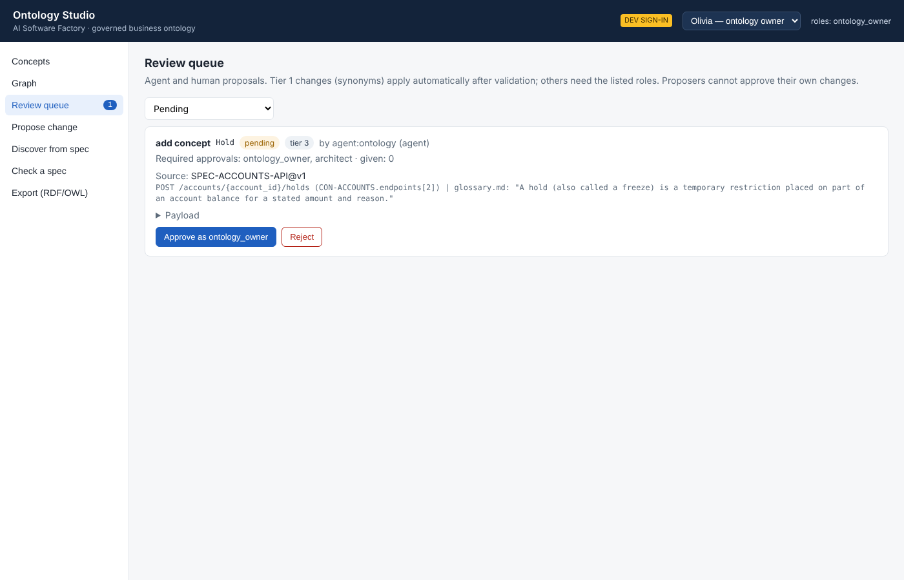
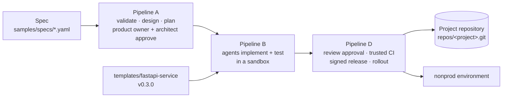
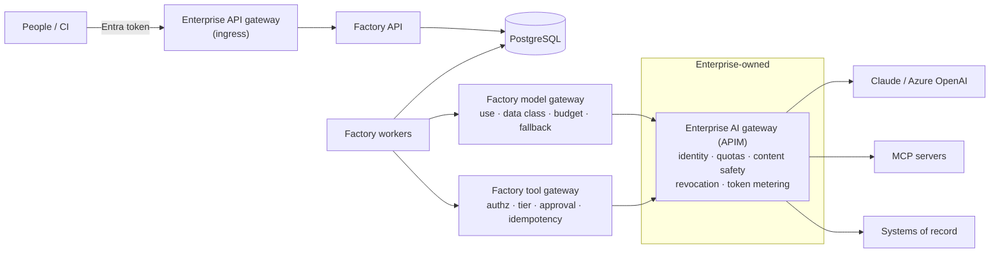
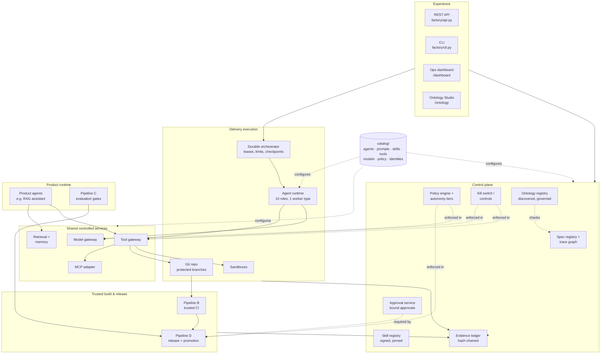
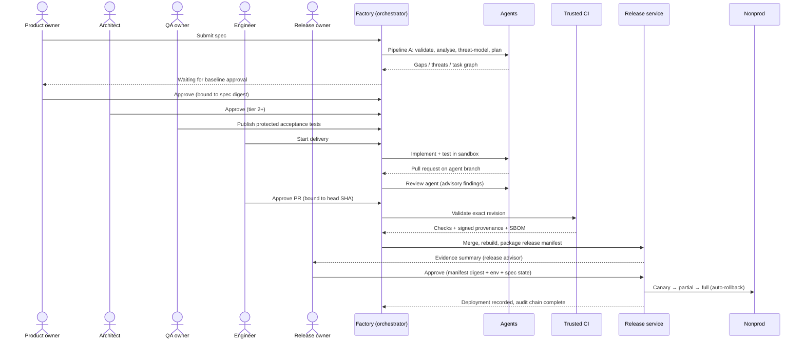
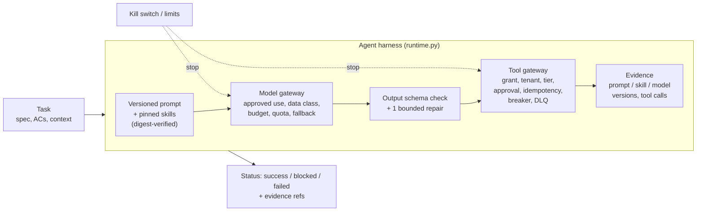
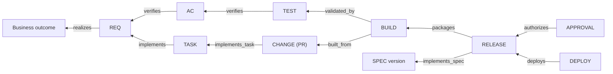

# AI Software Factory — production edition

A governed, spec-driven software factory that turns **approved business intent** into
**specified, implemented, tested and deployable** software using scoped agents and versioned
skills. It implements *AI_Software_Factory_Project_Requirements v2.0 (2026-11-23)*: production
scope on Azure, with an **enterprise AI gateway** as the single egress for model, MCP and
system-of-record traffic.

> **Production status.** Every production adapter (Entra ID, Key Vault, enterprise AI gateway, PostgreSQL,
> Kubernetes sandbox, GitOps) is implemented and tested over HTTP against a local Azure stand-in. None has yet
> been run against live Azure; that is acceptance scenario ACC 18 and the go-live gate. See `docs/production.md`.

---

## Key features: customizable · scalable · extensible · configurable

Every agent, skill, prompt, tool, model, policy and identity is a **versioned catalog entry**, not
hard-coded logic. Teams change factory behaviour by editing reviewed configuration, and the
factory pins, signs and records every version a run used.

### Configurable: one catalog for everything

| What | Where | Change it by | Code needed? |
|---|---|---|---|
| Agents (role, skills, model, tools, budgets, termination, output schema) | `catalog/agents/<role>.yaml` | Editing the manifest; bootstrap pins skill + prompt digests | No (with a real model) |
| Prompts (versioned, digest-pinned, per-prompt config) | `catalog/prompts/<id>[@version].yaml` | Adding a new version; agents pin `id` + `version` | No |
| Skills (instructions, inputs/outputs, capabilities, tests, risk) | `catalog/skills/<name>/` (`skill.yaml` + `SKILL.md`) | Publishing a new version; scanned, tested, signed | No |
| Policies + autonomy tiers | `catalog/policy/factory-core.yaml` (+ `.tests.yaml`) | Editing rules; the policy test suite must pass before load | No |
| Tool contracts (actions, schemas, side effects, retry, idempotency, concurrency) | `catalog/tools/<tool>.yaml` | Editing the contract | Implementation function for new tools; none for MCP tools |
| Model deployments (provider, approved uses, data classes, cost, quotas, fallbacks) | `catalog/models.yaml` | Editing the deployment list and egress allowlist | No |
| Identities, roles, grants, tenants | `catalog/identities.yaml` | Editing principals and grants | No |
| Capabilities skills may request | `catalog/capabilities.yaml` | Editing the list | No |
| Build standards (approved base images, protected paths) | `catalog/build-standards.yaml` | Editing the standards | No |
| Business ontology (concepts, attributes, relations, synonyms, business rules, actions) | `catalog/ontology/seed.yaml` + governed proposals | Ontology Studio (`/ontology`), API or CLI; discovery proposes changes automatically | No |
| Project setup (owners, risk tier, budget, template, skills) | `Factory.onboard()` / `POST /v1/projects` | API call | No |
| Runtime limits (time, attempts, tokens, cost, tool calls, fan-out) | per run (`limits`) and per agent manifest (`budgets`) | Request parameter or manifest | No |
| Runtime environment | env vars `FACTORY_HOME`, `FACTORY_SANDBOX`, `FACTORY_ALLOW_DEV_ISOLATION` | Environment | No |

### Customizable: per team, per project, per risk tier

- **Per project:** owners, tenant, risk tier, budget envelope, repository template and the
  allowed skill set are set at onboarding.
- **Per risk tier:** baseline approvals scale with risk (product owner only at tier 0–1;
  product owner + architect at tier 2+), and policy obligations decide the release approvers.
- **Per agent:** model tier and deployment, prompt version, pinned skills, tool grants, budgets
  and termination rules.
- **Per domain:** new business agents (for example loan or mortgage agents) are new manifests,
  prompts, skills and tool contracts on the same runtime and gates.
- **Per template:** add a template under `templates/` (for example Java or gRPC services); CI
  checks and promotion apply unchanged.

### Scalable: built for many teams and concurrent runs

- **Stateless workers with leases:** any worker can resume any run from its checkpoint; add
  workers to scale out.
- **Durable state store:** SQLite (WAL) in the reference build, with a schema portable to
  PostgreSQL for production.
- **Bounded admission:** the API returns a durable run id at once and rejects explicitly
  (HTTP 429) when capacity is reached, so accepted work is never silently dropped.
- **Bulkheads, circuit breakers, quotas:** per-tool concurrency limits, per-provider breakers
  and per-project model quotas stop one team or provider from starving others.
- **Budgets at the root run:** child runs and fan-out share the parent's limits, so cost scales
  predictably.
- **Multi-tenant isolation:** tenant and resource checks on every tool call, retrieval and API read.
- **Tested:** a 5× spike with a throttled model (ACC 08), at reduced scale (60 runs on 4 workers).
  The full NFR 03 load profile is still to be run.

### Extensible: adapters at every seam

| Seam | Current adapters | Add by |
|---|---|---|
| Model providers | offline (deterministic), Anthropic, Azure OpenAI | Provider class + entry in `catalog/models.yaml` |
| Orchestration | native durable engine; LangGraph adapter scaffold | Adapter that passes the lifecycle contract test |
| Spec formats | normalized factory spec; OpenSpec adapter | Import/export adapter (for example Spec Kit) |
| Tools | Python implementations; MCP servers | Contract + implementation, or an approved MCP server |
| Sandboxes | process (dev); container (`--network none`) | Backend class (for example gVisor or Kata) |
| CI checks | protected assets, SAST, secrets, IaC, tests, contract, reproducibility | Function added to `TrustedCI.run` |
| Evaluations | RAG suite with critical-category gates | New suite YAML in Pipeline C |
| Workflows | spec pipeline, delivery, release | New `Workflow` in `factory/workflows.py` (YAML definitions are on the roadmap) |

Extension never bypasses governance: new agents get grants only from `identities.yaml`, new
skills pass scanning and review, and every new tool or model sits behind the same gateways,
policy, approvals and evidence.

### Dynamic ontology: automatically discovered, human-governed

The factory keeps a versioned business ontology: concepts (attributes, relations, synonyms, data
classes), **business rules** (safe expressions that block, warn or require a named human approval)
and **actions** (typed operations such as `CreateHold`, the only governed way for people and agents
to change business objects; each run checks roles, evaluates the rules and calls the bound system
through the tool gateway). An extractor and the ontology agent **propose concepts automatically** from specs and
glossaries; synonyms apply automatically after validation, while new concepts, relations and
definition changes need the ontology owner and architect (plus data owner and security for
restricted data). Specs are checked against the ontology in Pipeline A, and a breaking concept change
marks dependent specs, releases and approvals stale. It's managed in **Ontology Studio** at
`/ontology`. See `docs/ontology.md`.



---

## Products built on the factory

| Product | Domain pack | What it shows |
|---|---|---|
| Accounts API (retail) | samples | Delivery slice, holds, RAG assistant |
| **Wealth advisory** | `catalog/domains/wealth-advisory` | New line of business by configuration: tenant, roles, governed suitability rules, product agents grounded in a deterministic calculation service, advisor-confirmed orders |
| **OSFI regulatory reporting** | `catalog/domains/osfi-regulatory-reporting` | Databricks lakehouse over an approved MCP server with pinned tools, BCBS 239 data quality, template-driven returns (LR, LCR), cell-level lineage, reproducible snapshots, maker-checker filing |
| **Retail account risk** | `catalog/domains/retail-account-risk` | Explainable fraud scoring with reason codes, AML indicators routed to the AML officer, credit early warning with an IFRS 9 stage indicator, analyst-confirmed restrictions, credit-officer limit reductions |

A new line of business = a domain pack (`project.yaml` + `ontology.yaml` + `evals.yaml`) plus catalog entries.
`python -m factory.cli domain load <name>` onboards it and proposes its ontology for owner approval.

## Software generated by the factory

Each domain pack also gets its own service, generated by the factory rather than written by hand. A product owner's
spec goes through Pipelines A (specification), B (delivery by agents) and D (trusted CI and release), starting from
`templates/fastapi-service`. Besides the original Accounts API sample, the factory has generated three services:

| Service | Spec | Project / tenant | Endpoints | Controls generated in |
|---|---|---|---|---|
| **Wealth Advice API** | `samples/specs/wealth-advice-api.v1.yaml` | `wealth-advisory` / wealth | `GET /accounts/{account_id}` · `POST /accounts/{account_id}/recommendations` | Scope and tenant checks on every handler; step-up authentication on writes; rationale and amount validation; idempotent writes |
| **Regulatory Returns API** | `samples/specs/regulatory-returns-api.v1.yaml` | `osfi-regulatory-reporting` / finance | `GET /returns` · `GET /returns/{return_id}` · `POST /returns/{return_id}/receipts` | Internal reviewer notes never returned; 404 across tenants; receipts only for certified returns (409 otherwise); step-up authentication for filing receipts |
| **Risk Cases API** | `samples/specs/risk-cases-api.v1.yaml` | `retail-account-risk` / retail | `GET /cases` · `GET /cases/{case_id}` · `POST /cases/{case_id}/notes` | Customer identifiers never returned; 404 across tenants; notes only on open cases (409 otherwise); minimum note length |



How each service relates to its product:

- **The generated service** handles access, validation and storage: who may read or write, in which tenant, and what is
  never disclosed.
- **The business rules** (suitability, filing certification, restriction thresholds) stay in the domain pack's ontology
  and run at runtime, so owners can change them under approval without regenerating the service.
- **The business process** (advisor flow, return preparation, risk monitoring) runs in the factory using its agents,
  gateways and ontology actions.

Generated code lands in each project's own repository (`$FACTORY_HOME/repos/<project>.git`), never in the template
folder. The repositories are created at run time, so they aren't in this zip. To produce them:

```bash
python -m factory.cli demo-wealth     # Wealth Advice API
python -m factory.cli demo-osfi       # Regulatory Returns API
python -m factory.cli demo-risk       # Risk Cases API
```

To support these services, the template grew from one built-in resource (accounts) to named collections (`accounts`,
`returns`, `cases`). Code generation gained per-endpoint `resource`, field exclusion on lists, required parent status
(`parent_must_have`) and string validation. The Accounts API still generates exactly as before.

## Production architecture: four gateway layers



| Layer | Owner | Decides |
|---|---|---|
| Enterprise API gateway | Enterprise | Who may reach the factory API |
| Factory model gateway | Factory | May this agent use this model for this purpose, data class and budget? |
| Factory tool gateway | Factory | May this actor do this action on this resource now, was it approved, has it already happened? |
| Enterprise AI gateway | Enterprise | May this workload use this asset at all, how much, and is the content safe? |

Revocation works at both the factory and enterprise layers independently. Production also adds Entra ID,
Key Vault HSM signing, zone-redundant PostgreSQL, separate API and worker deployments, Kata-isolated sandbox
Jobs, GitOps promotion with change-manager approval, OTLP tracing and a fail-closed preflight. Infrastructure:
`deploy/` (Terraform, Helm, APIM policies).

## Architecture

Diagrams are Mermaid (rendered by GitHub, GitLab and Azure DevOps). PNG copies are in `docs/diagrams/`.

### Layers and planes



### End-to-end delivery flow



### Agent harness: what wraps every model call



### Traceability graph



A new spec baseline supersedes changed REQ/AC nodes; every dependent TEST, BUILD, RELEASE and
APPROVAL becomes stale, stale approvals are revoked, and promotion refuses stale releases.

### Autonomy tiers (computed from the action, never chosen by the agent)

| Tier | Example actions | Control |
|---|---|---|
| 0 | Analysis, reads in sandbox/nonprod | Policy allow + evidence |
| 1 | Writes to agent branch, sandbox, review items | Scoped grant |
| 2 | Merge, nonprod deploy, reversible prod change | Bound human approval (role per policy) |
| 3 | Consequential, irreversible prod, restricted data, policy/permission change | Valid bound human approval, independent of author |

---

## Quick start

```bash
python -m factory.cli demo            # full slice end to end (~3 s, offline)
python -m factory.cli demo-rag        # bounded RAG agent + evaluation gate (ACC 07)
python -m factory.cli demo-production # production profile vs local Azure stand-in (Entra, Key Vault, AI gateway, OTLP)
python -m factory.cli preflight       # production invariants for the active configuration
python -m factory.cli demo-wealth     # second product: wealth advisory (domain pack, suitability rules, orders)
python -m factory.cli demo-osfi       # third product: OSFI returns from a Databricks lakehouse over MCP
python -m factory.cli demo-risk       # fourth product: retail fraud/AML monitoring and credit early warning
python -m pytest                      # 143 tests incl. ACC 01-17, ontology, production, wealth and OSFI reporting
python -m factory.cli serve           # API on :8088 · ops dashboard /dashboard · Ontology Studio /ontology
python -m factory.cli policy-test     # executable policy suite
python -m factory.cli audit REL-...   # auditor reconstruction of a release
```

State goes to `$FACTORY_HOME` (default `./.factory-home`). Requirements: Python ≥ 3.11 with
`pydantic`, `pyyaml`, `jsonschema`, `cryptography`, `starlette`, `uvicorn`, `pytest`; `git` on PATH.

## What is in the box

| Layer (Sec. 4) | Module | What it does |
|---|---|---|
| Experience | `factory/api.py`, `factory/cli.py`, `factory/ops/dashboard.py` | REST API (durable run ids, 429 admission), CLI, 3-plane ops dashboard |
| Control plane | `core/policy.py`, `core/approvals.py`, `specs/`, `skills/registry.py`, `core/evidence.py` | Executable policy + autonomy tiers, bound approvals, spec registry + trace graph, signed skill registry, hash-chained evidence ledger |
| Delivery execution | `orchestrator/engine.py`, `agents/`, `delivery/sandbox.py`, `delivery/repo.py` | Durable workflow engine (leases, checkpoints, limits), 10 agent roles on one worker type, sandboxes, git with server-side branch protection |
| Trusted build/release | `delivery/ci.py`, `delivery/release.py` | Pipeline B checks, QA-protected acceptance suite, reproducible build, signed provenance; Pipeline D promotion, staged rollout, rollback, drift |
| Product runtime | `product/rag_app.py`, `evals/harness.py` | Bounded RAG agent with read-only tools + human review queue; Pipeline C evaluation gate |
| Ontology | `ontology/registry.py`, `ontology/rules.py`, `ontology/actions.py`, `ontology/discovery.py`, `ontology/api.py`, `ontology/ui.html` | Versioned concepts, business rules, governed actions, automatic discovery, tiered approvals, impact/staleness, spec checks, RDF/OWL export, Ontology Studio UI |
| Shared services | `models/gateway.py`, `tools/gateway.py`, `tools/mcp.py`, `context/` | Model gateway (approved routing, quotas, budgets, fallbacks), tool gateway (authz, idempotency, breakers, DLQ, kill switch), MCP adapter, retrieval + memory |

Catalog (`catalog/`): 10 agent manifests, 10 versioned prompts (+1 candidate), **12 skill packages**, ontology seed,
9 tool contracts, identities, model deployments, policy + policy tests, build standards.
Template (`templates/fastapi-service/`): hexagonal FastAPI service, k8s manifests, Terraform, lockfile.

## Honest scope notes

- **Offline model provider by default.** Agents run against a deterministic provider so the whole
  governed pipeline is runnable and testable with no model access. Anthropic and Azure OpenAI
  providers are wired through the model gateway (`catalog/models.yaml`, credential via env/secret ref)
  but were not exercised here. Two offline handlers deliberately *follow injected instructions* so the
  tests prove containment comes from identity/policy/tool gateway, not model refusal.
- **Adding an agent role offline** also needs a handler in `factory/agents/offline.py`; with a real
  model deployment, a new role is configuration only.
- **Sandbox isolation:** `process` and `container` backends are dev-only; production uses Kubernetes Jobs on a
  Kata VM-isolation pool (manifest tested, cluster execution not run here).
- **FastAPI:** generated services keep business logic framework-neutral; the FastAPI adapter
  (`app/main.py`) is generated but FastAPI was not installed in the build environment, so tests and
  smoke checks run through the neutral dispatcher.
- **Production adapters vs stand-ins:** PostgreSQL, Entra ID, Key Vault, enterprise AI gateway, Kubernetes
  sandbox and GitOps adapters are built and selected by `profile: production`; the dev profile keeps SQLite,
  on-disk Ed25519 keys and dev tokens. Production adapters are tested against `enterprise/standin.py`, not live
  Azure; psycopg, terraform, helm and a Docker daemon were unavailable in the build environment, so the
  PostgreSQL run path, IaC and image build are unexecuted (`docs/production.md` §6). Ontology Studio sign-in is
  still a dev picker (MSAL not built). YAML policy engine (OPA/Cedar decision pending). Retrieval is BM25 +
  TF-IDF fused (no dense embeddings).
- **Not implemented:** REQ 034, REQ 057, REQ 088 (Harness/Helios adapter), REQ 089 (regional failover), gRPC
  adapter, Spec Kit adapter (OpenSpec chosen), YAML workflow definitions, retention schedules (NFR 11). See
  `docs/traceability.md` for per-requirement status.

## Plugging in a real model

Set `ANTHROPIC_API_KEY`, then point an agent at the approved deployment, e.g. in
`catalog/agents/planning.yaml`: `model.deployment: claude-delivery`. The gateway enforces the
deployment's approved uses and data classes, falls back only to explicitly approved deployments,
and every output still has to pass the agent's schema and the same downstream gates.
This direct-provider path is **dev only**: in production the factory holds no provider keys and every call goes
through the enterprise AI gateway (`catalog/models.production.yaml`).

## Docs

- `docs/retail-account-risk.md` — fourth product: fraud, AML and credit-risk monitoring workflow, features, gaps
- `docs/osfi-regulatory-reporting.md` — third product: regulatory returns workflow, feature list, controls, gaps
- `docs/wealth-advisory.md` — second product built on the factory: domain pack, suitability rules, controls, gaps
- `docs/production.md` — production profile, enterprise AI gateway contract, preflight, what is untested on live Azure
- `deploy/` — Terraform (Azure), Helm chart, APIM gateway policies, Dockerfile
- `docs/AI_Software_Factory_Project_Requirements_v2.0.docx` — requirements baseline (production scope)
- `docs/architecture.md` — layers, boundaries A–D, gateways, pipelines A–E, autonomy tiers, production topology
- `docs/traceability.md` — REQ/NFR/ACC → implementation → test, with status
- `docs/decisions.md` — inception decisions recorded as ADRs (defaults + revisit triggers)
- `docs/golden-path.md` — onboarding guide for a pilot team (ACC 10)
- `docs/runbooks.md` — kill switch (both layers), stuck run, DLQ replay, restore, key rotation, preflight failure
- `docs/ontology.md` — dynamic ontology: discovery, governance tiers, impact, UI/API/CLI
