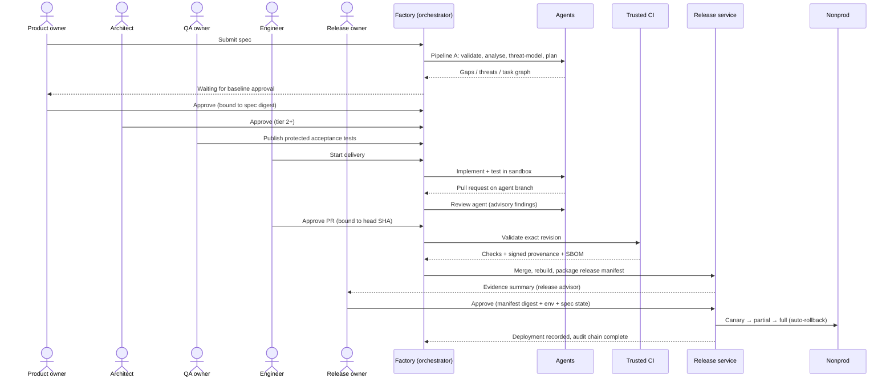
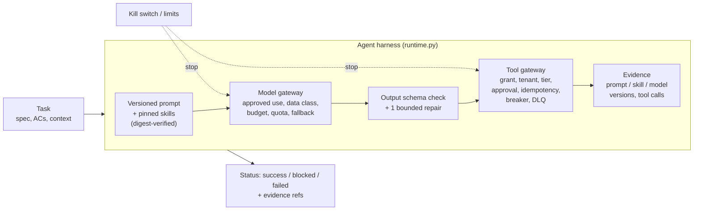
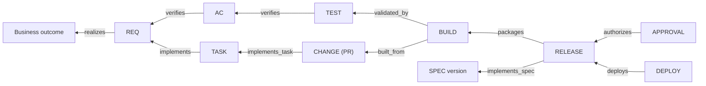

# AI Software Factory — reference implementation (MVP thin vertical slice)

A governed, spec-driven software factory that turns **approved business intent** into
**specified, implemented, tested and deployable** software using scoped agents and versioned
skills. It implements the MVP baseline in *AI_Software_Factory_Project_Requirements v1.0
(2026-11-06)*.

---

## Key features: customizable · scalable · extensible · configurable

Every agent, skill, prompt, tool, model, policy and identity is a **versioned catalog entry**, not
hard-coded logic. Teams change factory behaviour by editing reviewed configuration, and the
factory pins, signs and records every version a run used.

### Configurable: one catalog for everything

| What | Where | Change it by | Code needed? |
|---|---|---|---|
| Agents (role, skills, model, tools, budgets, termination, output schema) | `catalog/agents/<role>.yaml` | Editing the manifest; bootstrap pins skill + prompt digests | No (with a real model) |
| Prompts (versioned, digest-pinned, per-prompt config) | `catalog/prompts/<id>[@version].yaml` | Adding a new version; agents pin `id` + `version` | No |
| Skills (instructions, inputs/outputs, capabilities, tests, risk) | `catalog/skills/<name>/` (`skill.yaml` + `SKILL.md`) | Publishing a new version; scanned, tested, signed | No |
| Policies + autonomy tiers | `catalog/policy/factory-core.yaml` (+ `.tests.yaml`) | Editing rules; the policy test suite must pass before load | No |
| Tool contracts (actions, schemas, side effects, retry, idempotency, concurrency) | `catalog/tools/<tool>.yaml` | Editing the contract | Implementation function for new tools; none for MCP tools |
| Model deployments (provider, approved uses, data classes, cost, quotas, fallbacks) | `catalog/models.yaml` | Editing the deployment list and egress allowlist | No |
| Identities, roles, grants, tenants | `catalog/identities.yaml` | Editing principals and grants | No |
| Capabilities skills may request | `catalog/capabilities.yaml` | Editing the list | No |
| Build standards (approved base images, protected paths) | `catalog/build-standards.yaml` | Editing the standards | No |
<<<<<<< HEAD
| Business ontology (concepts, attributes, relations, synonyms, business rules, actions) | `catalog/ontology/seed.yaml` + governed proposals | Ontology Studio (`/ontology`), API or CLI; discovery proposes changes automatically | No |
=======
>>>>>>> 0bd01f492ebf87ee99ec46366eaaa1f6c5a22b40
| Project setup (owners, risk tier, budget, template, skills) | `Factory.onboard()` / `POST /v1/projects` | API call | No |
| Runtime limits (time, attempts, tokens, cost, tool calls, fan-out) | per run (`limits`) and per agent manifest (`budgets`) | Request parameter or manifest | No |
| Runtime environment | env vars `FACTORY_HOME`, `FACTORY_SANDBOX`, `FACTORY_ALLOW_DEV_ISOLATION` | Environment | No |

### Customizable: per team, per project, per risk tier

- **Per project:** owners, tenant, risk tier, budget envelope, repository template and the
  allowed skill set are set at onboarding.
- **Per risk tier:** baseline approvals scale with risk (product owner only at tier 0–1;
  product owner + architect at tier 2+), and policy obligations decide the release approvers.
- **Per agent:** model tier and deployment, prompt version, pinned skills, tool grants, budgets
  and termination rules.
- **Per domain:** new business agents (for example loan or mortgage agents) are new manifests,
  prompts, skills and tool contracts on the same runtime and gates.
- **Per template:** add a template under `templates/` (for example Java or gRPC services); CI
  checks and promotion apply unchanged.

### Scalable: built for many teams and concurrent runs

- **Stateless workers with leases:** any worker can resume any run from its checkpoint; add
  workers to scale out.
- **Durable state store:** SQLite (WAL) in the reference build, with a schema portable to
  PostgreSQL for production.
- **Bounded admission:** the API returns a durable run id at once and rejects explicitly
  (HTTP 429) when capacity is reached, so accepted work is never silently dropped.
- **Bulkheads, circuit breakers, quotas:** per-tool concurrency limits, per-provider breakers
  and per-project model quotas stop one team or provider from starving others.
- **Budgets at the root run:** child runs and fan-out share the parent's limits, so cost scales
  predictably.
- **Multi-tenant isolation:** tenant and resource checks on every tool call, retrieval and API read.
- **Tested:** a 5× spike with a throttled model (ACC 08), at reduced scale (60 runs on 4 workers).
  The full NFR 03 load profile is still to be run.

### Extensible: adapters at every seam

| Seam | Current adapters | Add by |
|---|---|---|
| Model providers | offline (deterministic), Anthropic, Azure OpenAI | Provider class + entry in `catalog/models.yaml` |
| Orchestration | native durable engine; LangGraph adapter scaffold | Adapter that passes the lifecycle contract test |
| Spec formats | normalized factory spec; OpenSpec adapter | Import/export adapter (for example Spec Kit) |
| Tools | Python implementations; MCP servers | Contract + implementation, or an approved MCP server |
| Sandboxes | process (dev); container (`--network none`) | Backend class (for example gVisor or Kata) |
| CI checks | protected assets, SAST, secrets, IaC, tests, contract, reproducibility | Function added to `TrustedCI.run` |
| Evaluations | RAG suite with critical-category gates | New suite YAML in Pipeline C |
| Workflows | spec pipeline, delivery, release | New `Workflow` in `factory/workflows.py` (YAML definitions are on the roadmap) |

Extension never bypasses governance: new agents get grants only from `identities.yaml`, new
skills pass scanning and review, and every new tool or model sits behind the same gateways,
policy, approvals and evidence.

<<<<<<< HEAD
### Dynamic ontology: automatically discovered, human-governed

The factory keeps a versioned business ontology: concepts (attributes, relations, synonyms, data
classes), **business rules** (safe expressions that block, warn or require a named human approval)
and **actions** (typed operations such as `CreateHold`, the only governed way for people and agents
to change business objects; each run checks roles, evaluates the rules and calls the bound system
through the tool gateway). An extractor and the ontology agent **propose concepts automatically** from specs and
glossaries; synonyms apply automatically after validation, while new concepts, relations and
definition changes need the ontology owner and architect (plus data owner and security for
restricted data). Specs are checked against the ontology in Pipeline A, and a breaking concept change
marks dependent specs, releases and approvals stale. It's managed in **Ontology Studio** at
`/ontology`. See `docs/ontology.md`.


=======
>>>>>>> 0bd01f492ebf87ee99ec46366eaaa1f6c5a22b40
---

## Architecture

Diagrams are Mermaid (rendered by GitHub, GitLab and Azure DevOps). PNG copies are in `docs/diagrams/`.

### Layers and planes

```mermaid
flowchart TB
    subgraph EXP["Experience"]
        API["REST API<br/>factory/api.py"]
        CLI["CLI<br/>factory/cli.py"]
        DASH["Ops dashboard<br/>/dashboard"]
<<<<<<< HEAD
        OSTU["Ontology Studio<br/>/ontology"]
=======
>>>>>>> 0bd01f492ebf87ee99ec46366eaaa1f6c5a22b40
    end

    subgraph CP["Control plane"]
        SPEC["Spec registry +<br/>trace graph"]
        POL["Policy engine +<br/>autonomy tiers"]
        APR["Approval service<br/>bound approvals"]
        SKR["Skill registry<br/>signed, pinned"]
        EVD["Evidence ledger<br/>hash-chained"]
        CTL["Kill switch /<br/>controls"]
<<<<<<< HEAD
        ONT["Ontology registry<br/>discovered, governed"]
=======
>>>>>>> 0bd01f492ebf87ee99ec46366eaaa1f6c5a22b40
    end

    subgraph DE["Delivery execution"]
        ORC["Durable orchestrator<br/>leases, limits, checkpoints"]
<<<<<<< HEAD
        AG["Agent runtime<br/>10 roles, 1 worker type"]
=======
        AG["Agent runtime<br/>9 roles, 1 worker type"]
>>>>>>> 0bd01f492ebf87ee99ec46366eaaa1f6c5a22b40
        SBX["Sandboxes"]
        REPO["Git repo<br/>protected branches"]
    end

    subgraph TB2["Trusted build & release"]
        CI["Pipeline B<br/>trusted CI"]
        REL["Pipeline D<br/>release + promotion"]
    end

    subgraph SH["Shared controlled services"]
        MGW["Model gateway"]
        TGW["Tool gateway"]
        MCP["MCP adapter"]
        RET["Retrieval +<br/>memory"]
    end

    subgraph PR["Product runtime"]
        RAG["Product agents<br/>e.g. RAG assistant"]
        EVAL["Pipeline C<br/>evaluation gates"]
    end

    CAT[("catalog/<br/>agents · prompts · skills · tools<br/>models · policy · identities")]

    EXP --> CP
    EXP --> ORC
    ORC --> AG
    AG --> MGW
    AG --> TGW
    TGW --> SBX
    TGW --> REPO
    TGW --> MCP
    RAG --> TGW
    RAG --> RET
    REPO --> CI
    CI --> REL
    EVAL --> REL
    CAT -. configures .-> CP
    CAT -. configures .-> AG
    CAT -. configures .-> SH
    POL -. enforced in .-> TGW
    POL -. enforced in .-> REL
    CTL -. enforced in .-> TGW
    CTL -. enforced in .-> MGW
    APR -. required by .-> REL
<<<<<<< HEAD
    ONT -. checks .-> SPEC
=======
>>>>>>> 0bd01f492ebf87ee99ec46366eaaa1f6c5a22b40
    CP --> EVD
    DE --> EVD
    TB2 --> EVD
```

### End-to-end delivery flow



### Agent harness: what wraps every model call



### Traceability graph



A new spec baseline supersedes changed REQ/AC nodes; every dependent TEST, BUILD, RELEASE and
APPROVAL becomes stale, stale approvals are revoked, and promotion refuses stale releases.

### Autonomy tiers (computed from the action, never chosen by the agent)

| Tier | Example actions | Control |
|---|---|---|
| 0 | Analysis, reads in sandbox/nonprod | Policy allow + evidence |
| 1 | Writes to agent branch, sandbox, review items | Scoped grant |
| 2 | Merge, nonprod deploy, reversible prod change | Bound human approval (role per policy) |
| 3 | Consequential, irreversible prod, restricted data, policy/permission change | Valid bound human approval, independent of author |

---

## Quick start

```bash
python -m factory.cli demo            # full slice end to end (~3 s, offline)
python -m factory.cli demo-rag        # bounded RAG agent + evaluation gate (ACC 07)
python -m pytest                      # 76 tests incl. acceptance scenarios ACC 01-09 and ontology
python -m factory.cli serve           # API on :8088 · ops dashboard /dashboard · Ontology Studio /ontology
python -m factory.cli policy-test     # executable policy suite
python -m factory.cli audit REL-...   # auditor reconstruction of a release
```

State goes to `$FACTORY_HOME` (default `./.factory-home`). Requirements: Python ≥ 3.11 with
`pydantic`, `pyyaml`, `jsonschema`, `cryptography`, `starlette`, `uvicorn`, `pytest`; `git` on PATH.

## What is in the box

| Layer (Sec. 4) | Module | What it does |
|---|---|---|
| Experience | `factory/api.py`, `factory/cli.py`, `factory/ops/dashboard.py` | REST API (durable run ids, 429 admission), CLI, 3-plane ops dashboard |
| Control plane | `core/policy.py`, `core/approvals.py`, `specs/`, `skills/registry.py`, `core/evidence.py` | Executable policy + autonomy tiers, bound approvals, spec registry + trace graph, signed skill registry, hash-chained evidence ledger |
| Delivery execution | `orchestrator/engine.py`, `agents/`, `delivery/sandbox.py`, `delivery/repo.py` | Durable workflow engine (leases, checkpoints, limits), 10 agent roles on one worker type, sandboxes, git with server-side branch protection |
| Trusted build/release | `delivery/ci.py`, `delivery/release.py` | Pipeline B checks, QA-protected acceptance suite, reproducible build, signed provenance; Pipeline D promotion, staged rollout, rollback, drift |
| Product runtime | `product/rag_app.py`, `evals/harness.py` | Bounded RAG agent with read-only tools + human review queue; Pipeline C evaluation gate |
| Ontology | `ontology/registry.py`, `ontology/rules.py`, `ontology/actions.py`, `ontology/discovery.py`, `ontology/api.py`, `ontology/ui.html` | Versioned concepts, business rules, governed actions, automatic discovery, tiered approvals, impact/staleness, spec checks, RDF/OWL export, Ontology Studio UI |
| Shared services | `models/gateway.py`, `tools/gateway.py`, `tools/mcp.py`, `context/` | Model gateway (approved routing, quotas, budgets, fallbacks), tool gateway (authz, idempotency, breakers, DLQ, kill switch), MCP adapter, retrieval + memory |

Catalog (`catalog/`): 10 agent manifests, 10 versioned prompts (+1 candidate), **12 skill packages**, ontology seed,
9 tool contracts, identities, model deployments, policy + policy tests, build standards.
Template (`templates/fastapi-service/`): hexagonal FastAPI service, k8s manifests, Terraform, lockfile.

## Honest scope notes

- **Offline model provider by default.** Agents run against a deterministic provider so the whole
  governed pipeline is runnable and testable with no model access. Anthropic and Azure OpenAI
  providers are wired through the model gateway (`catalog/models.yaml`, credential via env/secret ref)
  but were not exercised here. Two offline handlers deliberately *follow injected instructions* so the
  tests prove containment comes from identity/policy/tool gateway, not model refusal.
- **Adding an agent role offline** also needs a handler in `factory/agents/offline.py`; with a real
  model deployment, a new role is configuration only.
- **Sandbox isolation:** the default `process` backend (scrubbed env, rlimits, blackholed proxy) is
  dev-only; a `container` backend (`--network none --read-only --cap-drop ALL`) is used when
  `FACTORY_SANDBOX=container` and Docker is available. Hostile-code isolation (gVisor/Kata) is a Phase 0 spike.
- **FastAPI:** generated services keep business logic framework-neutral; the FastAPI adapter
  (`app/main.py`) is generated but FastAPI was not installed in the build environment, so tests and
  smoke checks run through the neutral dispatcher.
- **Stand-ins:** SQLite (→ PostgreSQL), on-disk Ed25519 keys (→ Key Vault/HSM), YAML policy engine
  (→ OPA/Cedar decision pending), local git (→ enterprise repo provider), local registry/environments
  (→ OCI registry + GitOps on AKS), dev bearer tokens (→ Entra ID). Retrieval is BM25 + TF-IDF fused
  (no dense embeddings).
- **Not implemented:** REQ 034, REQ 057, gRPC adapter, Spec Kit adapter (OpenSpec chosen), YAML
  workflow definitions, retention schedules (NFR 11), DR targets (NFR 05 regional). See
  `docs/traceability.md` for per-requirement status.

## Plugging in a real model

Set `ANTHROPIC_API_KEY`, then point an agent at the approved deployment, e.g. in
`catalog/agents/planning.yaml`: `model.deployment: claude-delivery`. The gateway enforces the
deployment's approved uses and data classes, falls back only to explicitly approved deployments,
and every output still has to pass the agent's schema and the same downstream gates.

## Docs

- `docs/architecture.md` — layers, boundaries A–D, gateways, pipelines A–E, autonomy tiers
- `docs/traceability.md` — REQ/NFR/ACC → implementation → test, with status
- `docs/decisions.md` — inception decisions recorded as ADRs (defaults + revisit triggers)
- `docs/golden-path.md` — onboarding guide for a pilot team (ACC 10)
- `docs/runbooks.md` — kill switch, stuck run, DLQ replay, recovery exercise, evidence verification
- `docs/ontology.md` — dynamic ontology: discovery, governance tiers, impact, UI/API/CLI
