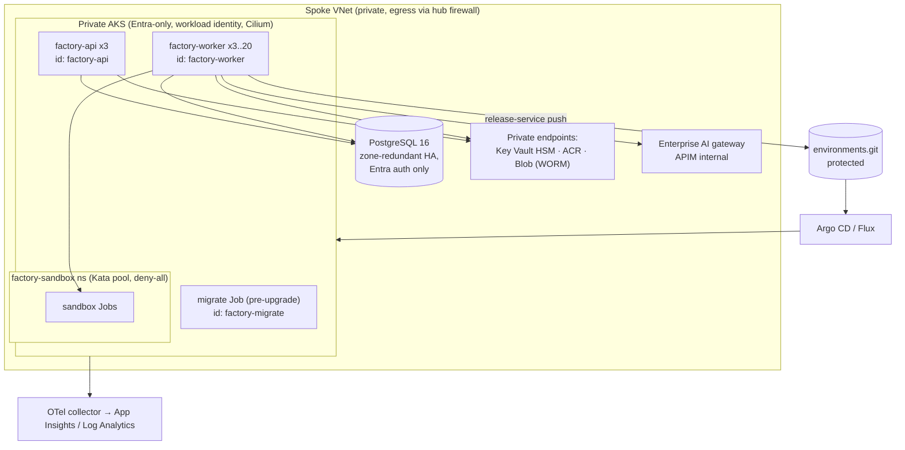

# Architecture

## Layers → code

1. **Experience** — `factory/api.py` (Starlette), `factory/cli.py`, `/dashboard`. Submission returns a durable run id; work executes on a bounded pool; full queues answer 429.
2. **Enterprise access** — inbound: Entra ID tokens validated by `enterprise/auth.py` (dev bearer tokens only outside production); backends still check tenant/resource per request. Outbound: the **enterprise AI gateway** (`enterprise/ai_gateway.py`) is the only egress for model, MCP and system-of-record calls in production.
3. **Control plane** — project registry (`Factory.onboard`), spec registry + trace graph (`specs/`), workflow definitions (`workflows.py`), agent/skill catalog (`skills/registry.py`, `agents` table), policy (`core/policy.py`), approvals (`core/approvals.py`), evidence (`core/evidence.py`).
4. **Delivery execution** — `orchestrator/engine.py` (durable state, leases, limits), `agents/runtime.py` (one worker type, manifest-scoped), `delivery/sandbox.py`, `delivery/repo.py`.
5. **Trusted build & release** — `delivery/ci.py` (identity `ci-builder`), `delivery/release.py` (identity `release-service`).
6. **Product runtime** — `product/rag_app.py` (separately identified product agent, read-only tools, human review queue).
7. **Shared controlled services** — `models/gateway.py`, `tools/gateway.py`, `tools/mcp.py`, `context/retrieval.py`, `context/memory.py`, `core/telemetry.py`, `core/controls.py`.

## Boundaries

| Boundary | Enforcement in code |
|---|---|
| A — delivery agents | Agent principals have only `agent/*` branch, sandbox and review grants; pre-receive hook rejects protected-branch pushes without the repo-service token; sandbox env is scrubbed (asserted); `KeyStore` refuses keys for non-trusted identities; policy denies `secrets.*` in prod, `deploy.execute`, `approval.approve`, `artifact.sign`, `policy.change` for `actor.kind=agent`. |
| B — trusted build/release | CI builds from `git archive <sha>`; acceptance tests come from the QA store bound to a QA approval; provenance is signed by `ci-builder`; promotion verifies signature, builder id, subject digest, approved source commit and registry blob. |
| C — conventional apps | Generated code passes the same PR review, CI, release approval as any code; the deployed artifact contains no agent, shell or skill loader. |
| D — product agents | Release bundle digest (manifest + prompt digest + pinned skill digests + tool contract digests + retrieval config); prompt content edits outside release fail the pinned digest; tool calls only via gateway under the product agent identity. |

## Gateways and orchestrator

- **Enterprise AI gateway** (enterprise-owned APIM, outside the factory): workload identity, enterprise quotas, content safety, per-asset revocation, token metering, upstream credentials. See `docs/production.md` §2 for the error contract.

- **Tool gateway** order of checks: kill switch (fail-closed on stale snapshot) → contract/input schema → identity grant + tenant + resource → tier classification → bound approval for tier 3 → policy decision → budget hook → op-id claim with payload binding (dedupe/reconcile) → bulkhead + circuit breaker + timeout + classified retry → DLQ → output schema → evidence.
- **Model gateway**: approved deployment, `narrow_model` control, workload grant, approved use, data class, project budget, per-project quota, breaker, approved-fallback chain (fallback must itself pass use + data-class checks and list the primary in `fallback_for`), usage accounting at root-run level, version/limitation evidence.
- **Orchestrator**: one engine owns state; steps checkpoint; approval waits persist; leases allow another worker to resume; deterministic op ids (`run:step:name`) make re-executed side effects reconcilable; cancellation propagates to children; limits charged to both run and root.

## Pipelines

| Pipeline | Implementation |
|---|---|
| A — spec | `spec_pipeline`: schema+completeness → contradiction review items → specification agent (clarifications block) → architecture agent (threats/ADRs) → planning agent (task graph) → baseline approval (PO, + architect at tier ≥ 2) → baseline + TASK trace nodes + invalidation of superseded evidence. |
| B — implementation | `TrustedCI.run`: protected-assets diff, dependency pinning, base-image rule, IaC policy, secret scan, SAST incl. "every scoped handler calls `require_scope`", unit tests, protected acceptance tests (per-AC JUnit results → TEST trace nodes), contract tests (route table + OpenAPI + breaking-change vs last release), byte-reproducible build twice, CycloneDX SBOM, signed in-toto/SLSA provenance. |
| C — AI behaviour | `evals/harness.py`: per-category scores with trials, separate retrieval metrics (recall@k, MRR), critical categories gate regardless of average, comparison against the active configuration. |
| D — release | `ReleaseService.create/promote`: signed manifest, evidence completeness, provenance verification, spec-baseline freshness, trace staleness, policy obligations → required roles, independent approver, evidence written before action, canary/partial/full with smoke + health hooks, rollback to previous digest. |
| E — operations | Kill switch controls, drift detection (`ReleaseService.drift`), ops-triage agent proposals, audit export, ledger verification. |

## Autonomy model

Tier is computed by `PolicyEngine.classify` from **action facts** (side effect, environment, data class, reversibility, governance actions) — any `tier` supplied by a caller is discarded. Tier 0 analysis; Tier 1 scoped nonprod writes; Tier 2 reviewed delivery actions / reversible prod; Tier 3 consequential, irreversible prod, restricted data, permission/policy changes → valid bound human approval required. Promotion to higher autonomy for a capability = a policy change (tier 3, independent review) backed by evaluation evidence.

## Traceability graph

Edges point from dependent to dependency: `AC→REQ→BO`, `TASK→REQ`, `CHANGE→TASK`, `TEST→AC`, `BUILD→TEST`, `BUILD→CHANGE`, `RELEASE→BUILD`, `RELEASE→SPEC`, `APPROVAL→RELEASE`, `DEPLOY→RELEASE`. Baselining a new spec version supersedes changed BO/REQ/AC nodes and marks every transitive dependent stale; stale approvals are revoked; promotion refuses releases with stale closures.

## Production topology (Azure)

Infrastructure: `deploy/terraform`; workloads: `deploy/helm/ai-software-factory`; gateway policies: `deploy/apim`.
Decisions: ADR-F11 to ADR-F17 in `docs/decisions.md`.
