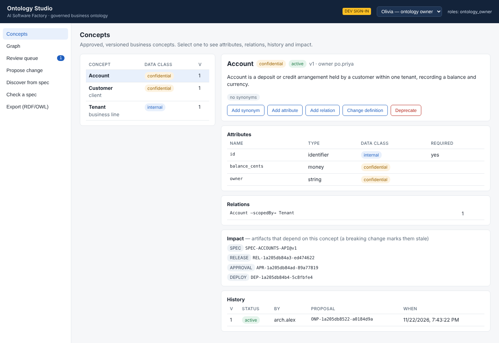
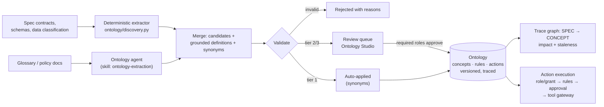
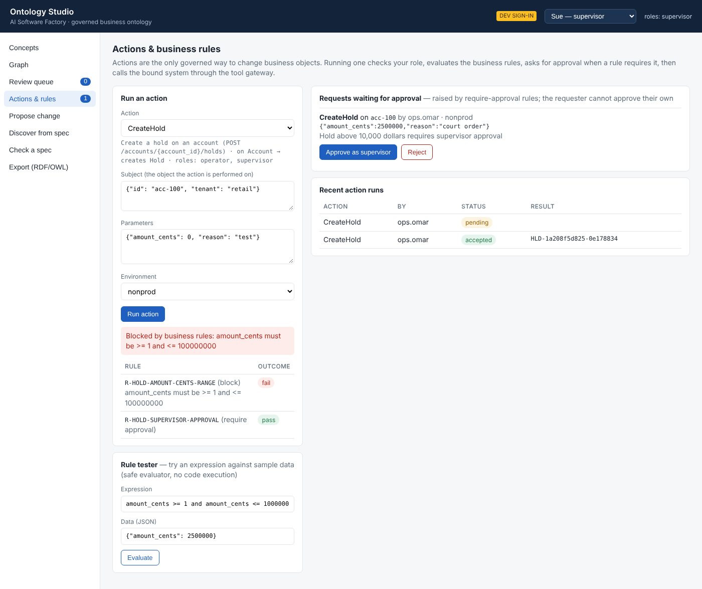

# Dynamic, governed business ontology

The ontology gives the factory one shared business model: **concepts** (Account, Hold, Customer…)
with attributes, relationships, synonyms and data classification; the **business rules** that
constrain them; and the **actions** that are the only governed way to change them. It is **dynamic**: agents and
extractors discover and propose changes automatically. It is **governed**: only validated, approved
changes enter the ontology, and a breaking change invalidates everything that depended on the old
meaning.

## How concepts are created automatically

1. **Extraction** (deterministic): resources from API paths become concepts, request-schema and
   classified fields become attributes, nested paths become `belongsTo` relations, and
   tenant-scoped APIs get `scopedBy Tenant`.
2. **Ontology agent**: reads glossaries and policy text and proposes definitions and synonyms, each
   with an evidence quote. It only defines candidate or existing concepts and ignores instructions
   embedded in documents.
3. **Validation**: naming rules, duplicates, ambiguous synonyms, relation targets, cardinality,
   attribute types, data class (an attribute can't be more sensitive than its concept), and
   provenance (source + evidence) are required.
4. **Tiered approval** (same autonomy model as the factory):

| Change | Tier | Approvers |
|---|---|---|
| Add synonym | 1 | none: applied after validation |
| Add attribute | 2 | data owner |
| Add concept / relation, change definition, deprecate | 3 | ontology owner + architect |
| Add / change / retire business rule | 3 | ontology owner + product owner |
| Add / retire action | 3 | ontology owner + architect (+ security if consequential or irreversible) |
| Anything touching `restricted` data | 3 | + data owner + security |

Changes to rules or actions on a concept that is still awaiting approval wait for it, then apply
automatically once their own approvals are complete.

The proposer can never approve their own change, agents can never approve, and approvals are bound
to the proposal payload digest and the target concept version.

## Business rules

A rule belongs to a concept and is written in a small, safe expression language (comparisons,
`and`/`or`/`not`, `in`, arithmetic, `len`/`lower`/`upper`/`abs`/`min`/`max`; no code execution):

| Field | Example |
|---|---|
| `id` | `R-HOLD-SUPERVISOR-APPROVAL` |
| `expression` | `amount_cents <= 1000000` (the condition that must hold) |
| `severity` | `block` (refuse), `warn` (record), `require_approval` (route to a human) |
| `approval_role` | `supervisor` (for `require_approval`) |
| `message` | "Hold above 10,000 dollars requires supervisor approval" |

Rules are discovered automatically: contract constraints (`minimum`/`maximum`) become `block` rules,
and the ontology agent turns policy sentences such as *"Holds above 10000 dollars require supervisor
approval"* into `require_approval` rules, with the sentence as evidence. Rules are business-owned:
adding, changing or retiring one needs the **ontology owner and the product owner**, and it is a
**breaking** change, so dependent specs, releases and approvals become stale until revalidated. A rule
that is still a precondition of an active action can't be retired.

## Actions

An action is a named, typed operation on a concept, for example `CreateHold` on Account (creates a Hold).

| Field | Meaning |
|---|---|
| `parameters` | Typed inputs; when the action `creates` a concept, every parameter must be one of its attributes |
| `preconditions` | Extra rule ids to check (rules of the created concept are always checked) |
| `side_effect`, `reversible` | `write` or `consequential`; consequential or irreversible actions also need security approval |
| `allowed_roles` | Human roles that may run it; agents need the grant `action:<Name>@<tenant>/*` |
| `tool` | Tool-contract binding (e.g. `holds.create`) that performs the change |

Running an action (`POST /v1/ontology/actions/{name}/execute` or the **Actions & rules** page):
1. checks the actor's role or agent grant and tenant (skills and prompts never grant actions);
2. type-checks parameters;
3. evaluates rules. `block` refuses; a rule that can't be decided because data is missing also
   refuses (fail closed); `warn` is recorded; `require_approval` creates a request bound to this
   exact action, subject, parameters and environment;
4. a human with the named role approves (never the requester), then the action runs;
5. the bound tool is called through the tool gateway by the `ontology-actions` workload on behalf of
   the actor, with a stable operation id, so retries never duplicate the write.

Actions are discovered from the API contract (one per creating operation) and need the ontology
owner and the architect. Adding an action is additive; retiring one is breaking. Pipeline A's spec
check warns when an endpoint has no governed action, or when a contract's limits disagree with a
`block` rule.

## Impact and invalidation

Concepts are nodes in the factory trace graph, and baselined specs link to the concepts they use.
- **Additive changes** (synonym, attribute, relation) create a new version; dependents stay current.
- **Breaking changes** (definition change, deprecation) supersede the concept node. Every dependent
  spec, release and approval becomes stale, stale approvals are revoked, and promotion is refused
  until the work is revalidated.
- **Impact analysis** (`GET /v1/ontology/concepts/{name}` or the Impact panel) lists dependent specs,
  releases, approvals and deployments before you change anything.

## Spec checks in Pipeline A

`validate` runs `check_spec` on every submitted spec:
- **error** (blocks the pipeline): a data class that conflicts with the ontology.
- **warning**: an unknown concept or attribute; run discovery or propose it.
- **info**: a synonym used where the canonical term is preferred.

## Using it

**UI** (Ontology Studio): `python -m factory.cli serve`, then open `http://127.0.0.1:8088/ontology`.
Pick a dev user in the header; production uses Entra ID SSO.

| Screen | What you do |
|---|---|
| Concepts | Browse; view attributes, relations, synonyms, history, impact; start a change |
| Graph | See concept relationships coloured by data class |
| Review queue | Approve as your role, or reject with a reason; see validation, provenance, payload |
| Actions & rules | Run an action, see each rule's outcome, approve or reject requests waiting on a rule, test an expression |
| Propose change | Manual proposals with provenance; validated immediately |
| Discover from spec | Run automatic discovery on a submitted spec plus pasted glossary text |
| Check a spec | Run the ontology consistency check |
| Export | Download RDF/OWL Turtle (OWL classes, properties, SKOS labels) |

**API**: `/v1/ontology/concepts`, `/concepts/{name}`, `/graph`, `/proposals`, `/proposals/new`,
`/proposals/{id}/approve`, `/proposals/{id}/reject`, `/discover`, `/check-spec`, `/export.ttl`, `/specs`,
`/actions`, `/actions/{name}/execute`, `/action-requests`, `/action-requests/{id}/approve`, `/action-requests/{id}/reject`, `/rules/test`.

**CLI**: `python -m factory.cli ontology list | proposals [status] | show NAME | impact NAME |
approve ID USER ROLE | reject ID USER REASON | discover SPEC_ID VERSION [DOC] | check SPEC_ID VERSION | export |
actions | rules | run ACTION USER SUBJECT_JSON PARAMS_JSON [ENV] | requests [STATUS] | approve-request ID USER ROLE | test-rule EXPR DATA_JSON`

**Configuration**: seed concepts in `catalog/ontology/seed.yaml`; agent in `catalog/agents/ontology.yaml`;
prompt in `catalog/prompts/ontology.yaml`; skill in `catalog/skills/ontology-extraction/`; roles
`ontology_owner`, `data_owner` and `supervisor` in `catalog/identities.yaml`; the `ontology-actions` workload
and its tool grants in the same file; the sample `holds` tool contract in `catalog/tools/holds.yaml`.

## Limits of this version

- Storage is the factory database with Turtle export; a graph store (Neo4j, GraphDB or Jena) is an ADR
  decision for later scale.
- Industry alignment (FIBO) is a `standard_ref` field; no IRIs are pre-filled, so verify them against
  the adopted FIBO release before adding them.
- With the offline stand-in, definitions come only from "A/An X is …" sentences in the documents
  supplied; a connected model would read richer sources.
- Graph-augmented RAG (following relations during retrieval) is designed but not built yet.
- Rules evaluate single objects (the created object, the subject, or both). Cross-object rules
  (for example "total holds on an account ≤ balance") need an aggregate data source and aren't built.
- The `holds` tool writes to a synthetic system of record; a real deployment binds actions to
  enterprise APIs through the same tool contracts.
