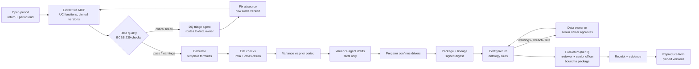

# OSFI regulatory reporting (domain pack `osfi-regulatory-reporting`)

The third product on the factory. It produces two OSFI returns from a Databricks lakehouse reached over MCP: the
Leverage Requirements Return (LR, quarterly) and the Liquidity Coverage Ratio return (LA, monthly). It uses the same
pattern as the wealth-advisory pack: a domain pack, a governed ontology, product agents that draft but never decide,
a deterministic engine, and ontology actions with named approvers.

```bash
python -m factory.cli domain load osfi-regulatory-reporting
python -m factory.cli demo-osfi                     # end to end, offline, synthetic lakehouse
python -m pytest tests/test_osfi_reporting.py       # 20 tests
```

> **Demo scope.** Calculations are simplified versions of the guideline mechanics (LR: Tier 1 / exposure measure;
> LCR: haircuts, Level 2 caps, 75% inflow cap). Template versions, cell numbering and filing deadlines must be
> confirmed against the current OSFI return instructions before any real use. The Databricks server and the filing
> channel are local stand-ins.

## Workflow



## Features a regulatory reporting solution needs, and where each lives

| # | Feature | How it works here | Where |
|---|---|---|---|
| 1 | Governed source access | Approved Databricks MCP server only: server identity, pinned protocol versions, **pinned tool input schemas** (a changed tool is refused until re-approved), unapproved tools ignored. Read-only Unity Catalog functions; no free-form SQL. Reads run as the `regrep-service` workload, never as an agent | `factory/tools/mcp.py` (`MCPToolset`), `catalog/mcp_servers.yaml`, `catalog/tools/lakehouse.yaml` |
| 2 | Point-in-time snapshot | Every read pins a Delta table version; the snapshot id is the digest of all versions | `regreport.extract` |
| 3 | Cell-level lineage | Each cell traces cell → formula → input → table@version → field | `regreport.cell_lineage` |
| 4 | Reproducibility | Re-run at pinned versions gives identical cells and snapshot, even after newer versions land | `RegReportingApp.reproduce` |
| 5 | Data quality (BCBS 239) | Completeness, load status, timeliness, validity, GL reconciliation; critical breaks block, warnings need the data owner | `regreport.data_quality`, `dq.yaml` |
| 6 | DQ triage and fix at source | Agent classifies each break and names the owning data team; the fix lands as a new version and the return is re-run | `reg-dq-triage` agent |
| 7 | Versioned return templates | Cells, formulas, headline ratio, requirement, frequency and filing days as reviewed configuration. Formulas run on the ontology's safe evaluator | `returns/LR.yaml`, `returns/LA.yaml` |
| 8 | Regulatory requirements | LR: 3% minimum plus a D-SIB buffer of 50% of the higher-loss absorbency surcharge (3.5% here). LCR: 100% | template `requirement` |
| 9 | Edit checks | Intra-return checks plus a cross-return check (LR Tier 1 equals the capital return) | template `edit_checks` |
| 10 | Variance analysis | Material = both ≥ 10% and ≥ CAD 5,000M vs prior period | `regreport.variances` |
| 11 | Grounded commentary | Agent drafts facts only. Invented numbers or driver claims ("due to", "driven by") are rejected; the preparer supplies the driver | `reg-variance-analyst`, `RegReportingApp.explain` |
| 12 | Certification rules | 10 ontology rules (below) | `ontology.yaml` |
| 13 | Breach escalation, not suppression | A ratio below its requirement still files, after senior-officer escalation | `R-RETURNCERTIFICATION-BELOW-REQUIREMENT` |
| 14 | Deadlines | Days to deadline from period end + filing days; late filing needs a senior officer | `R-RETURNCERTIFICATION-LATE` |
| 15 | Maker-checker and attestation | Filing is tier 3: reviewer **and** senior officer, distinct people, bound to the exact package digest | policy v1.3.0, `FileReturn` |
| 16 | Signed package | Package digest signed by the release signing key (Key Vault in production) | `RegReportingApp.package` |
| 17 | One filing per certification | Enforced in the app and again at the filing system of record | `filing_ticket`, `services.regulatory_filing` |
| 18 | Amendments | A refiling of a filed period is an amendment and needs a reason | `R-RETURNCERTIFICATION-AMENDMENT-REASON` |
| 19 | Evidence | Prepare, certify, approvals, filing and reproduction recorded in the hash-chained ledger | evidence ledger |
| 20 | Product evaluation gate | Critical: calculation accuracy, grounding, no invented drivers, reproducibility | `evals.yaml`, `regreport.evaluate` |
| 21 | Production routing | MCP goes through the enterprise AI gateway (`mcp_transport`); filing and registry through gateway APIs | `factory/factory.py`, `catalog/tools/*.yaml` |

### Ontology

| Concept | Purpose |
|---|---|
| `ReportingEntity` | Consolidated filer (D-SIB flag, higher-loss absorbency surcharge) |
| `RegulatoryReturn` | Return type: code, template version, frequency, filing days |
| `ReturnCertification` | Certified return for one period, with all the facts the rules check |
| `ReturnFiling` | Submission of a certified package, with receipt |

| Rule | Severity | Routed to |
|---|---|---|
| Critical DQ breaks open | block | |
| Edit check failed | block | |
| Lineage incomplete | block | |
| Material variance unexplained | block | |
| Amendment without reason | block | |
| DQ warnings | require approval | data_owner |
| Headline ratio below requirement | require approval | senior_officer |
| Past filing deadline | require approval | senior_officer |
| Filing without certification / package digest | block | |

Actions: `CertifyReturn` (reg_preparer; writes the return registry) and `FileReturn` (reg_preparer; consequential,
irreversible; needs reg_reviewer + senior_officer).

## Generated service: Regulatory Returns API

Like the other two products, this one also has a service the factory builds from a spec
(`samples/specs/regulatory-returns-api.v1.yaml`) through Pipelines A, B and D, starting from
`templates/fastapi-service`. Generated code lands in the project's own repository
(`$FACTORY_HOME/repos/osfi-regulatory-reporting.git`), never in the template folder.

| Endpoint | Scope | Behaviour |
|---|---|---|
| `GET /returns` | `returns:read` | Returns in the caller's tenant; reviewer notes excluded |
| `GET /returns/{return_id}` | `returns:read` | One return's status and headline ratio; 404 across tenants |
| `POST /returns/{return_id}/receipts` | `returns:file` + step-up | Records the regulator's receipt; 409 unless the return is certified |

To support it, the template (v0.2.0) gained named resource collections (`accounts`, `returns`), and code generation
gained `resource:`, `hide_fields` on lists, `parent_must_have` status checks and string validation. Existing
accounts and wealth services generate identically.

## What the demo shows

0. **Delivery:** the Regulatory Returns API is specified, built by agents from the template, verified by CI and released to nonprod.
1. **LR, Q4 2026:** 4.28% vs 3.5%. One material variance (derivatives +17.3%) is drafted by the agent, the preparer gives the driver, and the return is certified, approved by reviewer and senior officer, and filed.
2. **LCR, October 2026:** the Level 2B HQLA segment failed to load. That critical DQ break blocks certification, and triage routes it to the treasury data team. The fix lands as new Delta versions; the re-run gives 133.3%; the return is certified and filed.
3. **Audit:** the filed LR return reproduces identically from its pinned versions.

## Reuse from the platform

No changes to the core were needed beyond two generic additions: `MCPToolset` (a governed multi-tool MCP contract with schema pinning, connected on first use) and `rules.compute` (the same safe evaluator, returning values for formulas). Everything else (orchestration, policy, approvals, evidence, gateways, ontology, domain loader, agent runtime) was reused as-is.

## Not built

| Gap | Note |
|---|---|
| Capital (BCAR), NSFR, NCCF and other returns | Add as more templates; the engine is template-driven |
| Real filing channel | The OSFI RRS integration is not verified; the stand-in returns a receipt. Until it is, the filer uploads the signed package and records the receipt |
| Regulator file format | Output is a JSON package, not the RRS upload format |
| Unity Catalog permissions, async SQL polling, OAuth | Not emulated by the Databricks stand-in |
| Regulatory change agent | Would turn guideline changes into governed ontology rule proposals |
| Deadline alerts | Days to deadline is computed; no scheduled reminders yet |
| Records retention, SSO for the Ontology Studio | As for the other products |
| Model inventory (OSFI E-23) | Calculation engine and agents should be registered |
