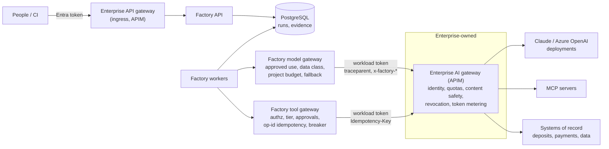

# Production profile (requirements v2.0)

Version 2.0 moves the factory from a pilot reference to a production service on Azure. This page covers how the
production profile works, how to configure it, what was verified, and what has **not** yet been run against live Azure.

## 1. What changes in production

| Concern | Dev / reference profile | Production profile | Code |
|---|---|---|---|
| Outbound AI and SoR traffic | Offline provider, local tool handlers | **Only via the enterprise AI gateway** (APIM); direct providers are removed at start | `enterprise/ai_gateway.py`, `models/gateway.py` (`AIGatewayProvider`), `enterprise/tools.py` |
| Human identity | Dev bearer tokens | Entra ID JWT (issuer, audience, signature, expiry); app roles → factory roles, groups → tenants; dev tokens disabled | `enterprise/auth.py` (`EntraValidator`) |
| Workload identity | n/a | Workload identity federation (service-account token → Entra); separate identities for API, worker, migrate | `enterprise/auth.py` (`WorkloadTokenProvider`), `deploy/terraform/main.tf` |
| Signing | On-disk Ed25519 | Key Vault HSM EC P-256, one key per signing identity, per-key RBAC; signatures prefixed `kv:` | `enterprise/keyvault.py` |
| Secrets | In-memory dict | Key Vault secrets read at use | `enterprise/keyvault.py` (`KeyVaultSecrets`) |
| State | SQLite | PostgreSQL Flexible Server (Entra token as password, append-only evidence trigger, advisory-lock ledger) | `core/db.py` (`PostgresDB`), `migrations/postgres/` |
| Execution | In-process pool | API persists runs; **separate worker deployment** claims them with leases | `orchestrator/engine.py` (`claim_next`, `work`, `requeue`), `cli.py worker` |
| Sandboxes | Process / container | Kubernetes Job, Kata VM isolation, no SA token, non-root, read-only, no egress | `delivery/sandbox.py` (`KubernetesSandbox`), `deploy/helm/.../sandbox.yaml` |
| Deployment | Local directory | **Pluggable target**: GitOps (protected environments repo) now; Harness/Helios adapter defined, refuses until built | `delivery/targets.py` |
| Prod promotion | Release owner | Release owner **+ change manager**, bound to a `CHGnnnnn` record, digest must have run in nonprod | `delivery/release.py`, `catalog/policies/factory-core.yaml` v1.1.0 |
| Telemetry | Metrics table | + OTLP traces with W3C `traceparent` and `x-factory-*` correlation headers on every gateway call | `core/tracing.py` |
| Start-up | Always starts | **Fail-closed preflight**; exemptions need owner, reason, expiry and are recorded as evidence | `config.py` (`preflight`) |

## 2. The four gateway layers



The enterprise AI gateway does **not** replace the factory gateways. It answers "may this workload use this asset at
all, and how much?"; the factory gateways answer "may this agent, in this run, for this project and data class, do this
action, and was it approved?". Revocation therefore works at two independent layers (REQ 074, runbook RB-11).

Error contract between the layers (`deploy/apim/models-policy.xml` ↔ `enterprise/ai_gateway.py`):

| Gateway response | Factory behaviour |
|---|---|
| 403 `AssetDisabled` / `Revoked` / `ApiDisabled` | Permanent for that asset: `model.enterprise_revoked` / `tool.enterprise_revoked` evidence; approved fallback only; no retry |
| 429 + `Retry-After` | Transient: breaker counts it, approved fallback or queue |
| 400 `ContentFiltered` | `ContentRejected`, no fallback (a different model would get the same content) |
| Timeout on a write | `OutcomeUnknown` → reconcile via `GET ?operation_id=` before any retry |

## 3. Configuration

`FACTORY_CONFIG` points at a YAML file (the Helm chart renders it from `values-<env>.yaml`). Keys: `profile`, `auth`,
`signer`, `secrets`, `models_catalog` (`models.production.yaml`), `execution` (`queue`), `sandbox_backend`,
`sandbox_runtime_class`, `deployment_target`, `gitops_repo`, `otel_endpoint`, `ai_gateway`, `entra`, `workload`,
`keyvault`, `exemptions`. Workload identity values come from the standard `AZURE_CLIENT_ID`, `AZURE_TENANT_ID`,
`AZURE_FEDERATED_TOKEN_FILE` injected by the AKS workload-identity webhook. The database URL comes from
`FACTORY_DATABASE_URL` and carries **no password**.

Agents never name a provider. Manifests use logical routes (`delivery-default`, `product-rag`); the production catalog
maps them to gateway aliases (`claude-delivery` → fallback `gpt-delivery`, `rag-assistant`).

```bash
python -m factory.cli preflight      # PASS/FAIL per check for the active configuration
python -m factory.cli worker         # queue worker
python -m factory.cli migrate --emit # regenerate migrations/postgres/001_init.sql from the schema
python -m factory.cli migrate --apply
python -m factory.cli demo-production  # production slice against the local Azure stand-in
```

## 4. Preflight checks (REQ 085)

`database` (PostgreSQL URL) · `auth` (Entra) · `workload_identity` · `signer` (Key Vault, all signing identities mapped)
· `secrets` (Key Vault) · `ai_gateway` (HTTPS base URL + audience) · `model_egress` (every deployment via gateway) ·
`tool_egress` (every non-internal tool contract via gateway) · `sandbox` (kubernetes) · `sandbox_runtime` (VM isolation
class) · `deployment_target` (not local) · `telemetry` (OTLP endpoint) · `execution` (queue).
Any failure → the process refuses to start. `/readyz` lists active exemptions; production should run with none.

## 5. How it was verified

`tests/test_production.py` (14 tests) runs the production profile over **real HTTP** against
`factory/enterprise/standin.py`, a local emulation of Entra ID (token endpoint, JWKS), Key Vault (keys with per-key
ACL, sign, secrets), the enterprise AI gateway (OpenAI-compatible chat with catalogue, revocation, content filter, token
limits; MCP; SoR APIs with idempotency) and an OTLP receiver. It covers ACC 14–17: revocation fallback and fail-closed,
throttling, content safety, enterprise kill switch on an ontology action, Entra token rejection cases, Key Vault grant
removal, queue workers, readiness, GitOps desired state, and every production-promotion denial path.

Full suite: **90 passed, 1 skipped** (skip: Docker daemon unavailable for the container sandbox).

## 6. Not yet run against live Azure — read before go-live

The adapters are written to documented APIs but were exercised **only against the stand-in**. Each item below is part
of ACC 18 and must pass in the enterprise development subscription with **no preflight exemptions**.

| Item | Risk if wrong | How it will be proven |
|---|---|---|
| Entra token exchange (`client_credentials` + federated assertion) and JWKS validation | Start-up or auth failures | ACC 17 in dev subscription |
| Key Vault `sign` (ES256) and public-key verification | Signatures unverifiable | ACC 17; verify an approval with `az keyvault key verify` |
| APIM policies (`deploy/apim/*.xml`): `validate-azure-ad-token`, `llm-token-limit`, `llm-content-safety`, error bodies | Error contract mismatch → wrong fallback behaviour | ACC 14 against the real gateway |
| PostgreSQL (`PostgresDB`, migrations, trigger, advisory lock) — **psycopg not installed here**; SQL translation and DDL are unit-tested only | Runtime SQL errors | Run the full suite with `FACTORY_DATABASE_URL` pointing at a dev server |
| Kubernetes sandbox execution via `kubectl` (manifest tested; run path not) | Build/test jobs fail | Run Pipeline B in dev AKS on the Kata pool |
| GitOps with a real reconciler (Argo CD/Flux) — tested with a local protected bare repo | Desired state not applied | Promote to nonprod in dev and check reconciler sync + smoke |
| Terraform / Helm (`deploy/`) — not `validate`d, `plan`ned or `lint`ed (tools unavailable) | Apply errors | `terraform plan` + `helm template` in CI, then apply to dev |
| Container image (`Dockerfile`) — not built (no daemon) | Build errors | Trusted CI build |

## 7. Known gaps (not built)

- **Ontology Studio and ops dashboard sign-in** still use the dev user picker. Production needs MSAL.js (auth code +
  PKCE) against the same Entra app registration; the API already accepts Entra tokens. Until then, expose the UIs
  in nonprod only.
- **Harness/Helios adapter** (REQ 088) — interface only; `HarnessHeliosTarget` raises `NotConfigured`.
- **Change-record validation** checks format and approval binding, not the record's state in ServiceNow; integrate the
  change system API before go-live.
- **Regional failover** (REQ 089) and retention schedules (NFR 11).
- **Evidence export to the WORM container** — the storage is provisioned; the exporter job is not written.
