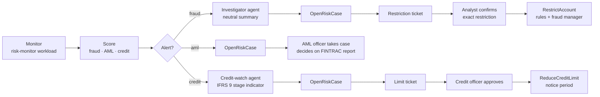

# Retail account risk (domain pack `retail-account-risk`)

The fourth product on the factory: fraud and AML transaction monitoring, plus a credit early-warning system
for retail accounts. It uses the same pattern as the other domain packs: governed ontology, deterministic scoring,
product agents that summarize but never act, ontology actions with named approvers, and a generated API.

```bash
python -m factory.cli domain load retail-account-risk
python -m factory.cli demo-risk                   # end to end, offline, synthetic data
python -m pytest tests/test_retail_risk.py        # 15 tests
```

> **Demo scope.** Scores are transparent rule-based points, not a trained model. Every threshold in `scoring.yaml`
> is a firm-policy assumption to confirm with Fraud, AML, Credit Risk and Legal. The factory never files FINTRAC
> reports: AML indicators route the case to the AML officer, who decides.

## Workflow



## Features applied

| # | Feature | How it works | Where |
|---|---|---|---|
| 1 | Explainable fraud scoring | Six weighted signals (velocity, amount spike, new device, impossible travel, new-payee transfer, card-not-present high-risk merchant). Every point has a reason code | `retailrisk.fraud_features`, `scoring.yaml` |
| 2 | AML indicators | 24-hour cash aggregation against the large-cash threshold, and a structuring pattern (several deposits just under $10,000) | `retailrisk.aml_indicators` |
| 3 | AML decisions stay with AML | AML indicators route the case to the AML officer; the factory never files FINTRAC reports | `R-RISKCASE-AML-REFERRAL` |
| 4 | Credit early warning | Days past due, utilization, bureau score drop, missed payments, NSF events | `retailrisk.credit_ews` |
| 5 | IFRS 9 stage indicator | Stage 2 over 30 days past due or on a score-drop trigger; stage 3 over 90 days. Passed to Finance as an input, not an accounting decision | `scoring.yaml` `credit.ifrs9` |
| 6 | Monitoring as a workload | Reads run as `risk-monitor`, never as an agent; each run is snapshotted and evidenced | `RetailRiskApp.monitor` |
| 7 | Neutral, grounded summaries | Agents cite only figures from reason codes; accusatory language ("fraudster", "committed fraud") is rejected | `ungrounded`, `ACCUSATORY_RE` |
| 8 | Evidence-based restriction | A restriction needs an open fraud case and a score at or above the restriction threshold | `R-ACCOUNTRESTRICTION-*` |
| 9 | Proportionality and consumer protection | Restrictions over 72 hours, or on a vulnerable customer, need the fraud manager | rules |
| 10 | Bound confirmation | Restricting is tier 3: the analyst confirms the exact restriction (type, duration, case) | policy v1.4.0 |
| 11 | Credit limit safeguards | Reduction only, never below the balance, needs early-warning evidence and the firm's notice period; a credit officer (not the analyst) approves | `R-CREDITLIMITCHANGE-*`, policy |
| 12 | One active restriction per case | Checked in the app and at the system of record | `restriction_ticket`, `services.account_controls` |
| 13 | Scoring as a governed model | `scoring.yaml` is versioned; the version is stamped on every alert and snapshot | OSFI E-23 inventory candidate |
| 14 | Product evaluation gate | Critical: alerting accuracy, grounding, fair language | `evals.yaml` |
| 15 | Generated Risk Cases API | List and read cases without customer identifiers; add notes only to open cases | `samples/specs/risk-cases-api.v1.yaml` |

### Ontology

Concepts: `MonitoredAccount`, `RiskCase`, `AccountRestriction`, `CreditLimitChange`.
Actions: `OpenRiskCase` (fraud or credit analyst; write), `RestrictAccount` (fraud analyst; consequential, reversible),
`ReduceCreditLimit` (credit analyst; consequential, irreversible once notice is sent).

| Rule | Severity | Routed to |
|---|---|---|
| Unknown case type, no reason codes, score out of range | block | |
| AML indicators present | require approval | aml_officer |
| Restriction without a case, below threshold, unknown type | block | |
| Restriction over 72 hours | require approval | fraud_manager |
| Vulnerable customer | require approval | fraud_manager |
| Limit change without a case, not a reduction, below balance, weak evidence, short notice | block | |

## Demo results (synthetic data)

| Account | Result |
|---|---|
| acc-101 | Fraud score 100 (all six signals) → case → 48-hour outgoing-payment restriction confirmed by the analyst. Also credit stage 3 (95 days past due) |
| acc-102 | Fraud score 45 → alert, but a restriction is blocked (below threshold). Credit EWS 80, stage 2 → limit cut from $25,000 to $23,000 with 30 days' notice, approved by a credit officer |
| acc-103 | No fraud alert; AML alert for cash over the 24-hour threshold plus a structuring pattern → AML officer takes the case |
| acc-100 | No alerts |

## Platform change this domain forced

When the last rule approval arrived, the action service ran the action on the approver's behalf. For a
consequential action that skipped the actor's own bound tool confirmation and failed. Now approvals complete the
request, and the actor runs it with the confirmation. Non-consequential actions still run on the final approval.

## Not built

| Gap | Note |
|---|---|
| Trained models | Rule-based points only; an ML model would need validation and monitoring under OSFI E-23 |
| Case outcomes and feedback | No close-out, false-positive tagging or threshold tuning loop yet |
| Customer contact and notices | Restriction and limit-change notices to customers are not generated |
| FINTRAC reporting | Deliberately out of scope; the AML team's own process files reports |
| Real-time streaming | Monitoring is batch over a transaction window, not event-driven |
| Lifting restrictions | Restrictions expire by duration; an explicit "lift" action is not built |
